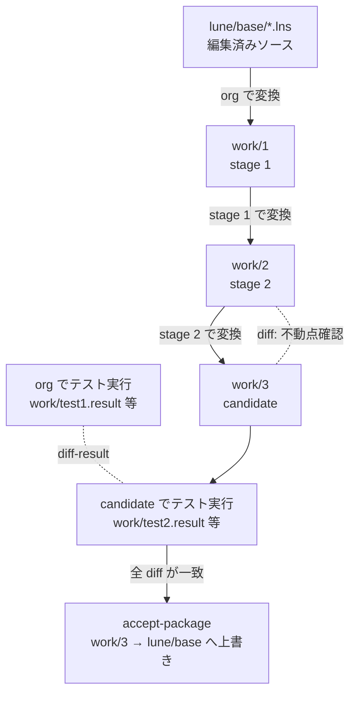

# `make test-comp` 解析

`src/Makefile` の `test-comp` は、LuneScript のセルフホストを検証する中心ターゲットである。
変更した `lune/base/*.lns` で新しいコンパイラを作り、それで自分自身を再コンパイルして
結果が一致すること (不動点) と、新旧コンパイラでテスト結果が一致することを確認する。
**全テストに合格すると、生成物 (`lune/base/*.lua` 等) を新しいものに自動で置き換える。**

> 行番号は分割前の `src/Makefile` (ブランチ `dev_with_llm`, `87ebeb68`) のもの。
> 分割後の `src/Makefile` は `src/mk/*.mk` に分かれている。行番号から分割後のファイルを探すには [makefile_split_plan.md](makefile_split_plan.md) の 8.1 の表を参照。

## 1. 全体像

用語:

| 呼称 | 実体 | 説明 |
|---|---|---|
| **org** (stage 0) | `src/lune/base/*.lua` (コミット済み) または `src/lnsc` (Go 版) | 現在のコンパイラ |
| **stage 1** | `work/1` | org で現在の `.lns` を変換したもの |
| **stage 2** | `work/2` | stage 1 のコンパイラで `.lns` を変換したもの |
| **stage 3 (candidate)** | `work/3` | stage 2 のコンパイラで `.lns` を変換したもの |



呼び出し構造:

```
test-comp                         (524)
├─ build-countup                  build.counter を +1
├─ stage 1 ビルド (work/1)
├─ build-testcode                 org でテストコードを work/1 に変換
├─ cp_src_set → work/2, work/3, work/5
├─ check-runtime-format           (1355)
└─ test-comp2                     (1059)
   ├─ test-comp2-main (lua) / test-comp2-para (go)
   │   ├─ stage 2, 3 ビルド + 不動点 diff
   │   ├─ test-parallel / test-serial   各種テスト
   │   ├─ test-lua51, luarocks-check, test-meta-update
   │   └─ check-rockspec, check-meta-format
   ├─ diff-result                 (1195) 新旧結果の一括比較
   └─ accept-package ACCEPT=y     (1303) candidate を正式版に昇格
```

## 2. ビルド環境設定

`test-comp` を実行する前に、Lua 5.3 本体と開発用ヘッダをインストールしておく。

```
$ sudo apt install lua5.3 liblua5.3-dev
```

- `lua5.3`: `LUA` の既定値 (`lua5.3`) として使い、Lua 版 lnsc (`lua lune/base/base.lua`) を実行する。
- `liblua5.3-dev`: `Makefile` は `pkg-config lua-5.3` で Lua のヘッダとライブラリを取得する (7–12 行)。
  C グルーコードのビルド (`build-glue`) などで必要になる。

CI (`.github/workflows/test.yml`) でも同じパッケージをインストールしている。

## 3. Lua 版 lnsc と Go 版 lnsc

`test-comp` は、org (現在のコンパイラ) として **Lua 版** と **Go 版** のどちらかを使う。

| 項目 | Lua 版 | Go 版 |
|---|---|---|
| 実行方法 | `make test-comp` | `make test-comp-with-go` (= `LANG_KIND=go WITH_GO=y`) |
| org の実体 | `LUA_PATH=./?.lua lua5.3 lune/base/base.lua` (コミット済みの `lune/base/*.lua`) | `src/lnsc` (Go でビルドしたバイナリ。**git 管理外**) |
| 変換速度 | 遅い | Lua 版の約 1/20 の時間 (README) |
| stage 1 の変換 | モジュールを 1 ファイルずつ `SAVE` (Lua 版は batch が遅いため) | 全モジュールを `@-` で一括変換 (batch) |
| `test-comp2` の流れ | `test-comp2-main` のみ | `test-comp2-main` と `test-comp2-sub`、`test-new3` を並列実行 |
| 出力の比較対象 | Lua 出力のみ | Lua 出力と Go 出力 (`COM_OPT` に `-langGo` が追加される) |
| Go 関連のテスト | 実行しない | `test-go` (org / candidate / `--disableGenInherit`)、shebang、単体バイナリ (`check_singleBin`) |
| Lua 版と Go 版の出力一致 | 確認しない | `work/13` (Lua 版で変換) と `work/3_3/work/3_3_3` (Go 版で変換) を diff |
| batch ビルドの不動点 | 確認しない | `test-new3` で 2 回 batch ビルドして diff |
| 期待値ファイル | 比較しない | `test/result/test1.result` と `work/test2.result` を diff (proj テスト有効時) |
| 成功時に更新されるもの | `lune/base/*.lua`, `*.meta`, `test/result/test1.result` | 左記に加えて `src/lnsc` と `lune/base/*.go` |

### 3.1 前提条件

| 前提 | Lua 版 | Go 版 | 理由 |
|---|:-:|:-:|---|
| `lua5.3` | 必須 | 必須 | Go 版でも `binding.go` の生成 (`bind.lns`) と `test/imp.lns` の実行には常に `LNSC_LUA` (Lua 版) を使う |
| `liblua5.3-dev` (`pkg-config lua-5.3`) | 必須 | 必須 | `build-glue` の C コンパイル。Go 版では cgo (`runtime_go/luaCore.go` の `#cgo pkg-config: lua-5.3`) でも使う |
| `gcc` | 必須 | 必須 | `build-glue`、cgo |
| `lune/base/*.lua` が `.lns` と対応している | 必須 | 必須 | Lua 版では org そのもの。Go 版でも `bind.lns` の実行に使う |
| Go (`go.mod` は `go 1.20` 以上) | 不要 | 必須 | Go 版 lnsc のビルドと Go 変換テスト |
| ネットワーク (Go モジュール取得) | 不要 | 必要 | `go mod tidy` で依存モジュール (`gopher-lua`, `groupcache`) を取得する。モジュールキャッシュにあれば不要 |
| `src/lnsc` (Go 版 lnsc) | 不要 | 必須 | Go 版の org。git 管理外のため clone 直後には存在しない |
| `rsync`, `/usr/bin/time`, `json_pp`, `python3` | 必須 | 必須 | 作業領域のコピー、時間計測、補完テストの整形、ソート |

`src/lnsc` が無い場合や古い場合は、`make go-build` で作る (3.3 参照)。
その後は、`test-comp-with-go` が成功するたびに `accept-package` が `src/lnsc` を新しいものに置き換える。

### 3.2 使い分けと注意点

- **普段の開発**: 速度を重視して `make -C src -j$(nproc) test-comp-with-go` を使う。
- **CI / Go 環境が無い場合**: `make -C src test-comp` を使う。CI は Lua 版で実行している。
- `make test-comp LANG_KIND=go` のように **`WITH_GO=y` を付けずに Go 版を使わない**。
  `-langGo` が `COM_OPT` に入らないため、`work/13` と `work/3_3` の出力の比較で前提が揃わなくなる。
  定義済みの組み合わせは `test-comp-with-go` である。
- **Lua 版だけで accept すると、Go 側の生成物が古いまま残る。**
  `accept-package` は `work/3/lnsc` がある場合にだけ `*.go` と `lnsc` を更新する。
  そのため、Lua 版 `test-comp` の後は `lune/base/*.go` と `src/lnsc` が `.lua` より古くなる。
  Go 版も使う場合は、最後に `test-comp-with-go` を実行して揃える。
- Go 版の org は `src/lnsc` そのものなので、`src/lnsc` が `lune/base/*.lua` と食い違っていると、
  Lua 版と Go 版で同じ `.lns` から異なる結果になりうる。
- `GOTAG=gopherlua` を付けると、cgo の代わりに gopher-lua (Lua 5.1 互換) でビルドする。
  この場合 `liblua5.3-dev` は Go のビルドには不要になるが、Lua 5.1 非互換のテストは除外される。

### 3.3 既存の lns コードから Go 版 lnsc をビルドする (`make go-build`)

`go-build` は、作業ツリーの `lune/base/*.lns` を Go に変換して Go 版 lnsc をビルドする。
`test-comp` と違ってセルフホストの不動点確認や `accept-package` は行わない。

```
$ cd src
$ make go-build NO_TEST=y                  # Lua 版 lnsc で変換 (src/lnsc が無くてもよい)
$ make go-build NO_TEST=y LANG_KIND=go     # 既存の src/lnsc で変換 (速い)
```

できたバイナリは `src/work/go/build/lnsc` に作られ、最後に **`src/lnsc` へ自動でコピー (上書き)** される。

#### 処理の流れ

| 手順 | 内容 |
|---|---|
| 1 | `rm -rf work/go` してから `setup-go` と `cp_src_set` でソース一式 (`*.lns`, `*.lua`, `runtime_go/` 等) を `work/go` にコピー |
| 2 | `selfhost_buildOp_batch`: org (`LANG_KIND` で選択) が `LNS_SRCS` の全モジュールを `-langGo --package lnsc` で一括変換し、`work/go/lune/base/*.go` を生成 |
| 3 | 変換結果を `work/go/build` にコピー |
| 4 | `binding-lns-go`: Lua 版で `misc/go/binding/bind.lns` を実行し、`binding.go` を生成 |
| 5 | `go-build-lns`: `misc/go/main/lnsc_main.go` をコピーし、`go mod init github.com/ifritJP/LuneScript/src` → `go mod tidy` → `go build -o lnsc` |
| 6 | `mk_runtime`: `runtime.lua` を生成 |
| 7 | (`NO_TEST` 未指定時) テストを実行 |
| 8 | `work/go/build/lnsc` を `src/lnsc` にコピー (wasm の場合は `src/lnsc.wasm`) |

#### オプション

| 指定 | 効果 |
|---|---|
| `NO_TEST=y` | 手順 7 のテストを省略する。省略しない場合は `test-govslua` (Lua 版と Go 版の変換結果・速度比較)、`test-lnsc-go` (`test-go` と、`lune/base` に頼らずに `testGo.lns` を実行できるか)、`test-error` の新旧比較を行う |
| `NO_ACCEPT=y` | 手順 8 のコピーを省略する。ビルド結果は `work/go/build/lnsc` に残り、`src/lnsc` は上書きされない |
| `LANG_KIND=go` | 手順 2 の変換に既存の `src/lnsc` を使う。省略時 (`lua`) は `lua5.3 lune/base/base.lua` を使う |
| `GOTAG=gopherlua` | cgo の代わりに gopher-lua (Lua 5.1 互換) でビルドする。`liblua5.3-dev` は Go のビルドには不要になる |
| `make build-wasm` | `GOOS=js GOARCH=wasm` と `GOTAG=gopherlua` で WebAssembly 版をビルドし、`src/lnsc.wasm` を出力する |

#### 注意点

- 前提条件は 3.1 の Go 版と同じ。手順 4 で必ず Lua 版を使うので、`LANG_KIND=go` でも `lua5.3` と `lune/base/*.lua` が必要になる。
- **既存の `src/lnsc` は確認なしで上書きされる。** 残したい場合は `NO_ACCEPT=y` を付けるか、事前に退避しておく。
- 変換元は作業ツリーの `.lns` である。`.lns` を変更していて Lua 版 (`lune/base/*.lua`) がまだ古い場合、
  古いコンパイラで新しいソースを変換することになる。言語仕様を変えた場合は `test-comp` で
  セルフホストを一巡させてから `go-build` すること。
- `lune/base/*.go` (コミット対象) は更新されない。更新されるのは `work/go` 以下と `src/lnsc` だけ。
- `NO_TEST` を付けないと、テストで `work/1`, `work/2` なども使うため、直前の `test-comp` の作業結果が上書きされる。

### 3.4 並列実行 (`-j`) とエラー時の切り分け

基本は `-j` を指定して並列に実行する。

```
$ make -C src -j$(nproc) test-comp-with-go
```

ただし `-j` を付けると、複数のテストのログが混ざって出力され、1 つが失敗しても実行中の
他のテストは終了まで動き続ける。そのため、エラーが起きたときにどこで失敗したのか分かりにくい。
エラーが出たら、次の手順で原因を調べる。

1. `-j1` を指定して同じコマンドを再実行する。単に `-j` を外すのではなく `-j1` を明示することで、
   環境変数 `MAKEFLAGS` などで `-j` が設定されていても確実に逐次実行になる。各処理が順番に実行され、
   最初に失敗した箇所で停止するので、ログの末尾を見れば失敗したコマンドと出力が分かる。

   ```
   $ make -C src -j1 test-comp-with-go
   ```

2. 失敗したターゲットが分かったら、`work/` に残っている結果ファイル
   (`work/test1.result` と `work/test2.result` など、5.8 の比較表を参照) を直接 diff して原因を調べる。

`-j1` での実行は時間がかかる。並列性を少し残したい場合は、`-j` のまま `TEST_SERIAL=y` を付ける方法もある。
`test-parallel` の代わりに `test-serial` が使われ、テストのカテゴリ (`test-org`, `test-new` など) が順番に実行される。

```
$ make -C src -j$(nproc) test-comp-with-go TEST_SERIAL=y
```

## 4. 主なパラメータ

| 変数 | 既定値 | 効果 |
|---|---|---|
| `LANG_KIND` | `lua` | org として使うコンパイラ。`lua`: `lua lune/base/base.lua`、`go`: `./lnsc`、`luarocks`: `~/.luarocks/bin/lnsc` |
| `WITH_GO` | (なし) | `y` で Go 版 lnsc のビルド・Go 変換テストを有効化 (`COM_OPT` に `-langGo` 追加) |
| `LUA` | `lua5.3` | 使用する Lua |
| `LUA51` | `lua5.1` | 空にすると Lua 5.1 クロステストを省略 |
| `batch` | (なし) | Go 版で `n` にすると、batch モードではなくモジュールごとにビルド |
| `TEST_SERIAL` | (なし) | `y` でテストカテゴリを逐次実行 (エラー箇所の特定用) |
| `SKIP_PROJ_TEST` | (なし) | `test/proj` のプロジェクトテストを省略 |
| `SKIP_CHECKING_TESTING` | (なし) | `--testing` を使うテストを省略 (CI で使用) |
| `SKIP_RUNTIME_VER_CHECK` | (なし) | `check-runtime-format` を省略 |
| `NO_LUAROCKS` | (なし) | `luarocks-check` を省略 |
| `NO_ACCEPT` | (なし) | `y` でテストのみ行ない、`accept-package` (成果物の上書き) を省略 |

`make test-comp-with-go` は `LANG_KIND=go WITH_GO=y` での `test-comp` (579)。

CI (`.github/workflows/test.yml`) では次のように実行している:

```
make -C src -j6 test-comp LUA=lua5.3 LUA51= SKIP_CHECKING_TESTING=y SKIP_PROJ_TEST=y
```

コンパイル時の共通オプション `COM_OPT` は `--use-ipairs -Werror --valid-luaval` (81)。
警告もエラーとして扱う。

## 5. 処理の詳細

### 5.1 前処理 (524–541)

1. `lune/` 以下に Emacs のロックファイル `.#*.lns` があればエラー終了する
   (`*.lns` の一括処理に巻き込まれてテストが失敗するため)。
2. `build-countup`: `build.counter` を 1 増やす。この値は各 `work/N` にコピーされる。
3. `rm -rf work/*` で前回の作業領域を削除する。
4. `work/1/lune/base`, `work/glue`, `work/newglue` を作成する。
5. `cp_src_set work/1 .` (465): ビルドに必要なソース一式をコピーする。
   - `Makefile`, `lune.js`, `build.counter`
   - `lune/base/` の `base*.lua`, `runtime*.lua`, `*.lns`, `*.d`
   - `runtime_go/`, `binding_dummy.go`, `DependLuaOnLns.go`, `misc/go/binding`, `misc/go/main/lnsc_main.go`

### 5.2 stage 1 ビルド: org → `work/1` (543–559)

| 条件 | 処理 |
|---|---|
| `LANG_KIND=lua` | `selfhost_build_dep`: org (Lua) で `LNS_SRCS` の各モジュールを **1 ファイルずつ** `SAVE` し、`--depends` で `.d` も出力する。Lua 版では batch 処理が遅いため。`WITH_GO=y` なら Go 版もビルドする |
| `LANG_KIND=go` (既定) | `selfhost_buildOp_batch`: `./lnsc @- SAVE work/1 --package lnsc` に全ソースを標準入力で渡して **一括変換** する。処理時間を `/usr/bin/time` で計測する |
| `LANG_KIND=go`, `batch=n` | Go 版をモジュールごとにビルドする |
| Go 版共通 | `binding-lns-go` (bind.lns で `binding.go` を生成) → `go-build-lns` (`go build -o lnsc`) → `mk_runtime` |

`LNS_SRCS` (215–262) は依存順に並べた 42 モジュールである (`Async` → … → `TransUnit` → `convLua` → `convGo` → … → `front`)。
`mk_runtime` (316) は `-mklunemod` で `runtime.lua` を生成し、`Ver.lua` の `luaModVersion` を付けた
`runtimeN.lua` にもコピーする。

### 5.3 テストコードの準備 (562–566)

- `test/` を `work/1` にコピーする。
- `build-testcode` (343): org で `test/macro.lns`, `Sub*.lns`, `Class*.lns`, `start.lns`, `mapping.lns` 等を
  `work/1/test/*.lua` に変換する。後で新コンパイラの出力 (`work/4`) と比較するためのもの。
- `work/1` を元に `work/2`, `work/3`, `work/5` の作業領域を作る。

### 5.4 `check-runtime-format` (1355)

`Ver.lua` の `luaModVersion` が org と stage 1 で同じなら、`runtime.lua` も同一でなければならない。
ランタイムを変更したのにバージョンを上げ忘れると、
`need to change the runtime version.` で失敗する。

### 5.5 stage 2/3 ビルドと不動点の確認: `test-comp2-main` (1091)

```
make -C work/2 build_from_d depend_on=y FROM_DIR=../1 TO_DIR=../2 LNS_OPT="--package lnsc"
make -C work/3 build_from_d depend_on=y FROM_DIR=../2 TO_DIR=../3 LNS_OPT="--package lnsc" SKIP_GO_BUILD=y
diff -u -r -I '_moduleObj.__buildId.*' -I '.*buildId = .*' -x lnsc -x binding.go work/2/lune work/3/lune
```

- `build_from_d` (91–111) は `.d` (依存関係) を `include` し、`%.meta: %.lns` ルールで
  変更のあったモジュールを `FROM_DIR` 側のコンパイラで変換して `TO_DIR` に出力する。
  `LNSC` は相対パス (`lune/base/base.lua` または `./lnsc`) なので、`cd $(FROM_DIR)` すると
  **そのステージのコンパイラ** が使われる。
- stage 2 と stage 3 の出力が buildId 以外で一致すれば、コンパイラは不動点に達している。
  つまり、新しいコンパイラは自分自身を正しくコンパイルできる。
- 時間短縮のため、work/3 では Go のビルドを省略し、`work/2/lnsc` をコピーして使う。

続けてテスト用の作業領域を用意する:

| ディレクトリ | 用途 |
|---|---|
| `work/3` + `test/` | candidate でテストを実行 |
| `work/newglue`, `work/3/test/glueTest.so` | candidate で生成した C グルーコードをビルド |
| `work/3_2` | `test-new2` 用 (work/3 のコピー) |
| `work/err_org` | org で `--disableGenInherit` 付き Go テスト |
| `work/err_new` | candidate で `--disableGenInherit` 付き Go テスト |

### 5.6 テスト本体: `test-parallel` / `test-serial` (1017)

`make -jN` を指定すると、以下のテストを並列に実行する。

| ターゲット | 実行するコンパイラ | 内容 | 主な出力 |
|---|---|---|---|
| `test-org` (815) | org | `start.lns` の `glue`/`ast`/`lua`/`exe`、`imp.lns`、補完テスト (`test-cmpl`)、エラーテスト (`test-error`)、`test-etc`、`convertLnsCode2LuaCode` API、shebang (Go)、`--testing` | `work/test1.result`, `work/ast1.result`, `work/lua1.result`, `work/org-error.result` |
| `test-org-proj` (865) | org | `test/proj` の複数モジュールプロジェクト | `work/0/log/proj` |
| `test-new` (878) | candidate | `test-org` と同じ内容に加え、`imp.lns` の `.meta` 生成と `.meta` からの import 確認 | `work/test2.result`, `work/ast2.result`, `work/lua2.result`, `work/new-error.result` |
| `test-new-proj` (924) | candidate | `work/3/test/proj` | `work/3/log/proj` |
| `test-new2` (935) | candidate | 変換後の Lua を **lnsc なしで** 実行 (`test3`)、`--default-lazy` で結果が **変わる** ことを確認 (`test3_2`)、`-r` でランタイムを読み込む形 (`test4`)、`--runtime` で別名ランタイム (`test4-2`)、`-u SAVE` で `work/4` に出力 (`test5`) | `work/test3..5.result`, `work/4/` |
| `test-comp-go-org` / `-new` | org / candidate (`WITH_GO=y` のみ) | `test-go`: `test/testGo.lns`, `subGoPkg` を Go に変換・ビルドして実行 | `work/result-testGo.txt`, `work/3/work/result-testGo.txt` |
| `test-comp-go-org-2` / `-new-2` | org / candidate | 上記を `--disableGenInherit` 付きで実行 | `work/err_*/work/result-testGo.txt` |
| `_test-testing_new` | candidate | 全モジュールを `--testing ast` で解析し、単体テストコードを確認 | `work/3/log/testing/` |
| `test-formatter` (2116) | org → 整形後のソースでビルド | `tools/formatter` で `lune/base/*.lns` を整形し、そこからコンパイラを再ビルドして `test-new` を実行 | `work/formatter/` |

エラーテスト (`test-error`, 732) は `test/error/` のケースを `diag` モードで解析し、
`error:` / `warning:` 行だけを抜き出して比較する。期待するエラーメッセージが変わっていないかを確認できる。

### 5.7 追加の確認 (`test-comp2-main` 後半)

| 処理 | 条件 | 内容 |
|---|---|---|
| `test-lua51` (1251) | `LUA51` が設定され、実行可能なとき | candidate を `-ol 51` で Lua 5.1 向けにクロスコンパイル (`work/5`) → Lua 5.1 で自分自身をコンパイル (`work/6`) → `work/5` と `work/6` を diff。gopher-lua での `test-go`、サンプルの 5.1 クロス実行も行う |
| `luarocks-check` (374) | `NO_LUAROCKS` が未設定のとき | rockspec から `luarocks make --local` でインストールして `start.lns` を実行し、`work/test.result` と比較してアンインストールする |
| `test-meta-update` (366) | 常に | `.meta` の一部を削除した状態からの再解析 (`test/ext/sub1..3`) |
| `check-rockspec` | 常に | rockspec に書かれた Lua ファイル一覧と `work/3` の実ファイルが一致するか |
| `check-meta-format` (1372) | 常に | `metaVersion` が同じなら、`Sub2.meta` の内容が org と candidate で一致するか。不一致なら `need to change the meta format version.` |

### 5.8 `diff-result` (1195): 新旧結果の一括比較

| 比較 | 確認すること |
|---|---|
| `work/1/test/*.lua` ⇔ `work/4/test/*.lua` | org と candidate のテストコード変換結果が同じ |
| `test/proj` ⇔ `work/3/test/proj` | プロジェクトのビルド結果 |
| `work/13/lune` ⇔ `work/3_3/work/3_3_3/lune` (Go のみ) | **Lua 版と Go 版のコンパイラが同じ出力をする** |
| `test/result/test1.result` ⇔ `work/test2.result` (Go, proj あり) | コミット済みの期待値と一致する |
| `test1` ⇔ `test2`, `org-error` ⇔ `new-error`, `ast1` ⇔ `ast2`, `lua1` ⇔ `lua2` | org と candidate のテスト結果・AST・Lua 出力が同じ |
| `test` ⇔ `test3` ⇔ `test4` ⇔ `test4-2`, `test4` ⇔ `test5` | 実行形態 (lnsc 経由、単体 Lua、ランタイム分離、`-u`) によらず結果が同じ |
| `work/1/start.dep` ⇔ `work/3_2/start.dep` | 依存関係の出力 |
| `work/glue` ⇔ `work/newglue` | C グルーコード生成 |
| `work/0-1/test` ⇔ `work/4/test` | ランタイムのバージョンが同じなら `.meta` も同じ |
| `result-testGo.txt` (org ⇔ new, err_org ⇔ err_new) | Go 変換コードの実行結果 |
| `diff-formatter` | 整形後のソースで作ったコンパイラでも結果が同じで、整形結果は元ソースと空白を除いて同じ |

Go 版 (`test-comp2-para`) では次の 2 つも並行して行う:

- `test-comp2-sub` → `work/13`: stage 1 のソースを **Lua 版** lnsc で `-langGo` 変換する。
- `test-new3` → `work/3_3`: stage 1 から batch ビルドを 2 回 (`3_3_2` → `3_3_3`) 行い、batch モードでも不動点になることを diff で確認する。

### 5.9 `accept-package ACCEPT=y` (1303): candidate を正式版に昇格

`ACCEPT=y` が付いているため、確認なしで次のファイルを上書きする:

- `work/test2.result` → `test/result/test1.result`
- `work/3/lune/base/*.lua`, `*.meta` → `lune/base/`
- (Go) `work/3/lnsc` → `./lnsc`、`work/3/lune/base/*.go` → `lune/base/`
- (Lua 5.1) `work/6` の成果物 → `runtime_go/legacy/lua51/`、`binding51.go` を生成

これで candidate が次回の org になる。

## 6. 注意点

- **成功すると作業ツリーが書き換わる。** `lune/base/*.lua`, `*.go`, `*.meta`, `lnsc`,
  `test/result/test1.result` が更新されるので、実行後は `git diff` で差分を確認すること。
  失敗したときは途中で止まるため、昇格は行われない。
  テストだけを行いたい場合は `NO_ACCEPT=y` を付ける。
- **`luarocks-check` はユーザー環境を変更する。** `luarocks remove/make --local` で
  `~/.luarocks` の `lunescript` を入れ直して最後に削除する。避けたい場合は `NO_LUAROCKS=y` を指定する。
- `work/` は毎回 `rm -rf work/*` で削除される。
- ランタイム (`runtime.lua`) やメタ形式を変更したときは、`Ver.lns` のバージョンを上げないと
  `check-runtime-format` / `check-meta-format` で失敗する。
- `-j` で並列実行すると失敗箇所が分かりにくい。エラー時は `-j1` を指定して再実行する (3.4 参照)。
- `--default-lazy` のテストは、結果が **異なる** ことを期待している
  (`diff ... && exit 1 || echo ok`)。
- `WITH_GO=y` では `check_singleBin` で lnsc 単体バイナリからバインド済みコードを読み込めることも確認する。

## 7. `work/` ディレクトリ一覧

| パス | 作成元 | 用途 |
|---|---|---|
| `work/0/log`, `work/0-1` | test-org | org のログ、org の `-u SAVE` 結果 |
| `work/1` | org | stage 1 |
| `work/2` | stage 1 | stage 2 |
| `work/3` | stage 2 | stage 3 (candidate)、テスト実行 |
| `work/3_2`, `work/4` | candidate | test-new2 (単体 Lua 実行、`-u SAVE` 出力) |
| `work/3_3` | stage 1 | batch ビルドの不動点確認 (Go) |
| `work/5`, `work/6`, `work/6_2`, `work/7` | candidate | Lua 5.1 クロスコンパイル |
| `work/8` | candidate | luarocks インストール確認 |
| `work/13` | stage 1 (Lua 版) | Lua 版と Go 版の出力比較 (Go) |
| `work/err_org`, `work/err_new` | org / candidate | `--disableGenInherit` での Go テスト |
| `work/glue`, `work/newglue` | org / candidate | C グルーコード |
| `work/formatter` | formatter | 整形後のソースでのビルド・テスト |
| `work/*.result` | 各テスト | 比較対象の結果ファイル |
