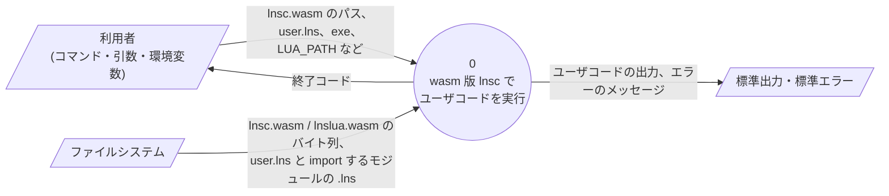
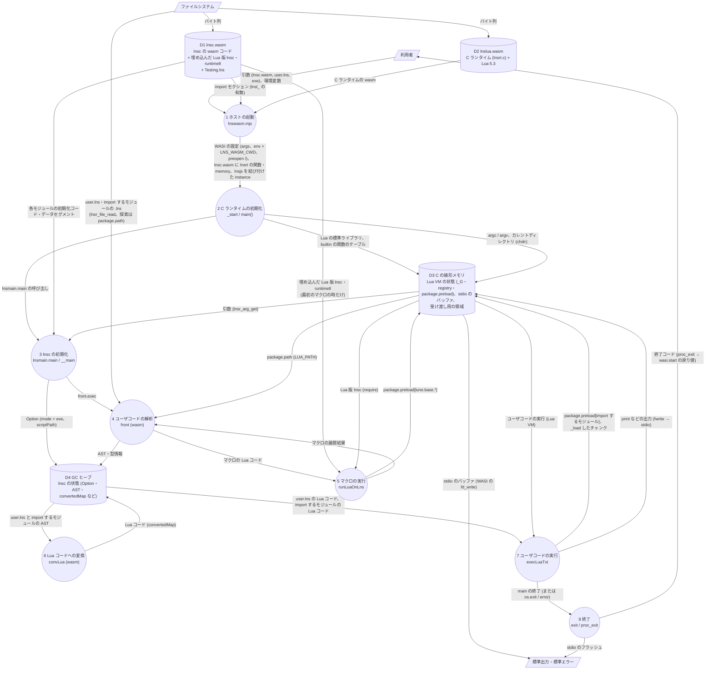

# LuneScript から wasm への直接変換 (WasmGC 方式) の設計検討

LuneScript のコードを、Go を経由せずに wasm へ直接変換するための設計方針・課題・進め方をまとめる。
未解決の課題・未修正の不具合・Lua 版との既知の差は、[wasm_issue.md](wasm_issue.md) にまとめる。
Go 経由の方式 (案 A) との比較は [wasm_support.md](wasm_support.md) を参照。

> 調査対象: ブランチ `dev_with_llm` (`f86d38c0`)。実験環境: Node.js v22.22.1 (V8 12.4)。
> wasm の各提案 (GC、例外処理、スレッドなど) の状況は執筆時点の認識であり、着手時に確認すること。

## 1. 方針 (決定事項)

| 項目 | 決定 |
|---|---|
| 変換方式 | `.lns` を wasm へ **直接** 変換する (新しいバックエンド `convWasm`、`-langWasm`) |
| メモリ管理 | **WasmGC** (GC は実行環境に任せる)。wasm のマルチスレッドはまだ仕様が固まっておらず、今使うのは非効率なため。マルチスレッドは仕様が固まってから検討する |
| 目標の順序 | (1) 簡単なテストコードが動く → (2) `make` で実行しているテストに合格する → (3) セルフホストできる |
| ランタイム | 初期は LuneScript 以外の言語で書いてよい。最終的には、ブートストラップとごく一部の例外を除いて LuneScript で書く (セルフホスト構成) |
| Lua 連携 | 序盤は不要。セルフホストには必須 (マクロの評価に Lua の VM を使うため。3.3 参照)。**C の Lua 実装を wasm に変換して取り込む** |

## 2. 目的と期待する効果

| 目的 | Go 経由 (案 A) の現状 | WasmGC 方式で期待すること |
|---|---|---|
| サイズ・ロード時間 | hello でも 7.5 MB (gzip 後 1.7 MB) | GC とアロケータを含めなくてよいので、ランタイムを小さくできる。WasmGC のサンプル (構造体と配列を使う 2 関数) は 134 バイト |
| ヒープの使用量 | 箱詰め・`[]LnsAny` の生成・全オブジェクトのヒープ割り当てが多い (6 章) | 型をそのまま wasm の struct / array にでき、`int` などを箱詰めせずに扱える。単相化・エスケープ解析で、さらに減らす |

## 3. 調査結果

### 3.1 実行環境での WasmGC の動作確認

構造体 (`struct.new` / `struct.get`) とバイト配列 (`array.new` / `array.len`) を使う wasm をバイナリで直接生成し、
Node.js v22 (V8 12.4) で実行して、正しい結果になることを確認した。

- この環境の wabt (`wat2wasm` 1.0.36) は GC の命令に対応していない。
  lnsc がバイナリを直接出力する方針なので問題ないが、デバッグ用に GC 対応のツール (Binaryen の `wasm-opt` / `wasm-dis` など) があると便利 (9 章)。

### 3.2 `make` で実行しているテスト

| テスト | 使われ方 | wasm 版での扱い |
|---|---|---|
| `test/tutorial/*.lns` (20 件) | `make test-tutorial` など | 最初の目標 (M1) |
| `test/testGo.lns` (+ `test/subGoPkg`) | `make test-go` (Go 変換のテスト)。Lua 版の実行結果 (`shebang`) と比べる | M2 の中心。Go と同じく Lua 以外への変換を前提にしたテストで、`/.nolua51./` のような印で対象外の部分を除ける |
| `test/start.lns` | `test-comp` の主なテスト (2,166 行) | M2 の後半。C のグルー (`module GlueTest require ... glue`)、`__luago`、`import.l` / `import.d` (遅延ロード)、`lune.base.Writer` の import などを含むので、Lua 連携 (M3) が必要な部分は除いて始める |
| `test/error/*` | コンパイルエラーのテスト | コンパイラ (フロントエンド) のテストなので、バックエンドには関係しない |

### 3.3 セルフホストに Lua 連携が必須である理由

マクロは、`Macro.lns` がマクロの本体を Lua のコードに変換し、`_load` (Lua の `load`) で実行して評価している
(`loadCode`、`evalFromCodeToLuaCode` / `evalToLuaCode`)。そのため、lnsc 自身を wasm で動かすには Lua の VM が必要になる。

## 4. 全体構成

```
                ┌─────────────── コンパイル時 (lnsc) ───────────────┐
.lns ─▶ 構文・意味解析 ─▶ AST (型付き) ─▶ convWasm ─▶ IR ─▶ 最適化 ─▶ wasm 出力 ─▶ app.wasm
                                                                        │
                ┌─────────────── 実行時 ─────────────────────────────┐   ▼
                │ app.wasm (WasmGC)  ◀─▶  ランタイム  ◀─▶  ホスト (Node.js / ブラウザ / WASI) │
                │                         └─(M3 以降) lua.wasm (C の Lua、線形メモリ)       │
                └────────────────────────────────────────────────────┘
```

- **IR**: 序盤から、型付きで、wasm の構造化制御 (block / loop / if) に近い木構造の IR を置く。
  最初は AST をほぼそのまま下ろすだけにし、最適化 (単相化、エスケープ解析、箱詰めの除去、インライン展開) は後から IR の上に追加する。
  後から IR を差し込むのは大きな手戻りになるため、最初から形だけでも用意する。
- **wasm 出力**: LuneScript でバイナリを直接出力する (LEB128、各セクション、GC の命令)。デバッグ用に、テキスト形式 (WAT 風) のダンプも出せるようにする。
- **プログラム全体の変換**: import している全モジュールを 1 つの wasm にまとめる。未使用コードの除去と単相化がプログラム全体で効くため。

### 4.1 wasm 版 lnsc のブートストラップ (ユーザコードを実行するまで)

M4 (14.8)・WASI 対応 (14.10)・Lua 版 lnsc の埋め込み (14.11) の後の構成で、
wasm 版の lnsc でユーザコードを `exe` で実行する (`node lnswasm.mjs lnsc.wasm user.lns exe`) までの処理を DFD で示す。

レベル 0 (全体):



レベル 1 (ブートストラップの詳細):



| 番号 | 処理 | 内容 |
|---|---|---|
| 1 | ホストの起動 (`lnswasm.mjs`) | `lnsc.wasm` の import セクションを読み、Lua の関数 (`lnsl_`) を使っていれば `lnslua.wasm` を選ぶ (lnsc は使う)。`node:wasi` で WASI を用意する (引数、環境変数に `LNS_WASM_CWD` を追加、`/` を preopen)。C ランタイムを instance にした後、`lnsc.wasm` に C ランタイムの関数と memory (`lnsrt`) と、Node.js 専用の関数 (`lnsjs`。Lua の値の解放・`popen`) を結び付けて instance にする。最後に `wasi.start()` で C ランタイムを起動する |
| 2 | C ランタイムの初期化 | wasi-libc の初期化 (preopen・環境変数) の後、`main()` で引数を保存し、`LNS_WASM_CWD` に `chdir` する。`lnsr_initExt()` で Lua の VM を作り、標準ライブラリと builtin の関数 (`format`・`_load`・`runLuaOnLns` 用の Lua のコードなど) を登録する。その後 `lnsmain.main` (lnsc の `main`) を呼ぶ |
| 3 | lnsc の初期化 | lnsc の全モジュールのトップレベルを実行する (グローバル変数・クラスの情報など)。`__main` に引数の List を渡し、`front.exec` → `Option.analyze` で `exe` モードの設定を作る |
| 4 | ユーザコードの解析 | `user.lns` と import するモジュールを、`package.path` (`LUA_PATH`、未設定なら Lua の標準のパス) で探して読み、AST を作る。ファイルの読み込みは C ランタイムの stdio を使う |
| 5 | マクロの実行 | マクロがある場合だけ行う。最初の `runLuaOnLns` で、埋め込んだ Lua 版 lnsc と runtime8 を `package.preload` に登録する (1 回だけ)。Lua 版 lnsc の `DependLuaOnLns` が、マクロの Lua コードを wasm の中の Lua で実行し、展開結果を wasm 版の lnsc に返す |
| 6 | Lua コードへの変換 | wasm 版 lnsc の `convLua` が、`user.lns` と import するモジュールを Lua コードに変換する |
| 7 | ユーザコードの実行 | import するモジュールの Lua コードを `package.preload` に登録し (`setupPreloadWithImportedModules`)、`user.lns` の Lua コードを `_load` して実行する (`execLuaTxt`)。ユーザコードは wasm の中の Lua で動き、`print` は C の stdio に書く |
| 8 | 終了 | `main` から戻ると C の `main()` が終わり、`exit()` で stdio をフラッシュして `proc_exit` する。`os.exit` や `error()` の場合は、その場で `exit` する |

- wasmtime で実行する場合、処理 1 は `lnswasi.sh` が行う (`wasm-merge` で `lnsc.wasm`・`lnslua.wasm`・`lnsjs_stub.wasm` を 1 つの WASI の wasm にまとめ、wasmtime で実行する)。処理 2 以降は同じ。
- D3 の Lua の VM と C の stdio は、同じ C ランタイムの中にある。そのため、lnsc 自身の出力 (wasm の `print`) とユーザコードの出力 (Lua の `print`) は同じ stdio のバッファを通り、順番が保たれる。
- D1 の埋め込んだ Lua 版 lnsc は、処理 5 (マクロの実行) でだけ使う。マクロの無いユーザコードでは読み込まない。
- `exe` で生成した Lua コードは runtime を各ファイルに展開するので、ユーザコードは通常 lnsc のモジュールを `require` しない。
  `lune.base.Testing` などを import した場合は、処理 7 で D3 の `package.preload` から読み込む。

## 5. 型の対応 (WasmGC)

| LuneScript | wasm での表現 | 備考 |
|---|---|---|
| `int` | `i64` | |
| `real` | `f64` | |
| `bool` | `i32` | |
| `str` | `(ref $Str)`: 不変のバイト配列 `(array i8)` を持つ struct | Lua と同じくバイト列。ハッシュ値をキャッシュする欄を持たせる |
| `nil` | `ref.null` | |
| nilable のスカラー (`int!` など) | 初期は箱詰め (`(ref null $BoxI64)`)。最適化で、局所変数では「値 + フラグ」の組にする | |
| class | struct。先頭にメソッド表 (vtable) への参照、続いて親クラスのフィールド、自クラスのフィールド | WasmGC の struct の部分型 (`sub`) で継承を表す。ダウンキャスト・型判定は `ref.cast` / `ref.test` / `br_on_cast` |
| interface | 初期は、オブジェクトのメソッド表から interface ごとの表を引く | 後で最適化する |
| `List<T>` / `Array<T>` | 長さと要素配列を持つ struct | 初期は要素を `anyref` で持つ (スカラーは箱詰め)。単相化で `(array i64)` などに特殊化する |
| `Map<K,V>` / `Set<T>` | ランタイムで実装するハッシュ表 | WasmGC には参照の同一性に基づくハッシュ値が無いので、オブジェクトにハッシュ値の欄を持たせる |
| 関数・クロージャ | 関数参照と捕捉した変数を持つ struct。呼び出しは `call_ref` | |
| ジェネリクス | 初期は型消去 (`anyref` + 箱詰め)。最適化で単相化する | ヒープ削減の主な対象 |
| alge | バリアントごとに部分型の struct。`match` は `br_on_cast` で分岐する | |
| 多値の戻り値 | wasm の複数戻り値 | |
| `error()` | 序盤はホストにメッセージを出して `unreachable` で停止する | LuneScript のコードには例外を捕まえる構文が無いので、序盤は wasm の例外処理を使わなくてよい。Lua 連携 (`pcall` など) で必要になったら検討する |

## 6. ヒープの使用を減らす最適化 (IR の上で行う)

Go 変換の出力 (`hello.lns` の例) でヒープを使っている箇所と、WasmGC 方式での対策。

| Go 変換の出力 | 対策 |
|---|---|
| `List` / `Map` の要素が `LnsAny` で、`int` も箱詰めされる | 単相化で要素型ごとの配列にする |
| 要素を取り出すたびに型アサーション | 単相化で不要になる |
| すべてのオブジェクトをヒープに置き、自分を指す `FP` フィールドを持つ | エスケープ解析で、外に出ないオブジェクトはフィールドを局所変数に分解する。継承されないクラスのメソッド呼び出しは直接呼び出しにする |
| `print` などの呼び出しのたびに `[]LnsAny` を作る (`Lns_2DDD`) | 引数の数が分かる呼び出しは展開する。多値は wasm の複数戻り値にする |
| nilable を `LnsAny` で表す | 局所変数では「値 + フラグ」の組にする |
| すべての関数に `_env` を渡す | 1 スレッドなのでグローバル変数にする |

## 7. ランタイム

### 7.1 必要な機能

| 分類 | 内容 |
|---|---|
| 文字列 | 連結、比較、`sub`、`byte`、`rep`、`lower` / `upper`、`format` (Lua の書式)、`find` / `gsub` / `gmatch` (**Lua のパターン**)、数値との変換 |
| コレクション | List / Array (`insert`、`remove`、`sort`、`unpack`)、Map、Set (`add`、`del`、`has`、`and`、`or`、`sub`、`clone`、`len`) |
| 入出力 | `print`、`io.stdout` / `stderr` / `stdin`、ファイル (`open`、`read`、`write`、`seek`、`close`)、`os` (`clock`、`time`、`date`、`exit`、`remove`、`rename`) |
| 非同期 | `__Runner`、`__Processor`、`__run` / `__join`。1 スレッドで順に実行する (Lua 版と同じ動き) |
| その他 | Mapping (`_toMap` / `_fromMap`) のための型情報、`math` |

### 7.2 何で書くか (段階的に移行する)

C や Rust は WasmGC の参照型を直接扱えないので、GC のオブジェクトを扱う部分には使えない。そこで次のように分ける。

| 段階 | GC のオブジェクトを扱う部分 (文字列、コレクションなど) | ホストとのやり取り (入出力など) |
|---|---|---|
| 初期 (M0〜M2) | **convWasm の中に、IR で書いた組み込み関数として持つ** (lnsc が wasm 出力と同時に生成する) | **JavaScript** (Node.js / ブラウザ用の薄い層) |
| 中期 (M3〜M4) | 同上 | WASI に対応する (ファイルアクセスなど、セルフホストに必要なもの) |
| 最終 (M5) | **LuneScript で書く**。メモリや wasm 命令を直接使うための最小限の組み込み関数 (intrinsic) を用意する | ホストとの境界の薄い層と、C の Lua だけを例外として残す |

Lua 互換の処理 (`string.format`、パターンなど) は、互換性を優先して C の Lua をそのまま使う (7.3)。

### 7.3 Lua のランタイムを使う処理と自前で実装する処理

Lua のランタイムの動作を前提にしている処理は、wasm にした C の Lua (`lnslua.wasm`) をそのまま使う。
ただし、Lua を使えない処理や、Lua を使う利点が無い処理は自前で実装する。

| 機能 | 実装 | 理由 |
|---|---|---|
| `string.format` (`"%s" (x)` 構文も含む) | 自前 + **Lua** | 書式の細部 (`%g` / `%q` / 幅・精度・エラー) まで一致させるため Lua を使う。ただし、`%s`・`%d`・`%c`・`%%` だけの書式は自前で処理する (go 版と同じ二段構え。14.9 で実装した) |
| 実数の文字列化 (`%.14g`) | **Lua** | 正確な丸めを自前で実装するのは難しい |
| `find` (パターン)・`gsub`・`gmatch`・`match` | **Lua** | lstrlib そのものを使えば移植による差が無い。`find` の `plain` 指定と、特殊文字を含まないパターンは自前の単純な検索で処理する (14.9) |
| `tonumber` | **Lua** | 16 進・指数・空白などの解釈規則が多く、実数は `strtod` の正確な丸めが必要 |
| `_load`・`require` (Lua のモジュール)・`Luaval`・`string.dump` | **Lua** (必須) | Lua そのもの |
| `error()` | 自前 | wasm の例外処理で実装する。Lua の `pcall` 経由では GC ヒープ側の状態を巻き戻せない |
| 等価・大小・ハッシュ (int と real の同一視など)、`//`・`%`・シフト、`@@@int` | 自前 | 言語の意味そのもので、全ての演算に関わる。Lua を呼ぶと遅すぎる |
| `print`・オブジェクトの `tostring` (`table: 0x...`) | 自前 | 実数の部分だけ Lua を呼ぶ |
| `sort` | 自前 | Lua 側から GC の List を扱えない。Lua の `table.sort` は不安定ソートで、同値の要素の順序は Lua でも決まっていない |
| 文字列の比較 | 自前 | C ロケールの `strcoll` (バイト比較) と同じ |
| `byte`・`rep`・`lower`・`upper`・`reverse`・`sub`・`len`・`replace` | 自前 | 数行で書ける (Lua も C ロケールでは ASCII のみ)。呼び出しごとの文字列のコピーの方が高くつく。M2 では Lua を呼んでいたが、14.9 で自前にした |
| `math.floor` など | 自前 | wasm の命令で済む |
| `math.random` | 自前 | Lua でも libc 依存で、結果の一致は期待されていない |
| `io.*`・`os.*` | C のランタイム (WASI。14.10) | Lua ではなく OS の機能。M2〜M4 では Node.js のホストの関数で実装していた。`io.popen` は Node.js でのみ対応する |

Lua を使う場合の注意点:

- 呼び出しごとに、GC ヒープの文字列と Lua の線形メモリとの間でコピーが必要になる。
  `AsyncTokenizer.lns` のように同じ文字列に開始位置を変えて何度も `find` するコードでは、
  直前にコピーした文字列を再利用する仕組みが必要になる (未対応)。
- Lua を使うプログラムは `lnslua.wasm` (約 190KB) を読み込む。どの関数を使うかはコンパイル時にわかるので、
  Lua の関数を使う場合だけ import する。ただし、`print` で `stem` を出力するだけでも実数の文字列化のために Lua を import する。

## 8. Lua 連携の設計 (M3)

| 項目 | 方針 |
|---|---|
| Lua の取り込み | C の Lua 5.3 を clang (wasi-sdk) で wasm にコンパイルする。線形メモリを使う別モジュール `lnslua.wasm` になる (14.4 で実装した) |
| 結合 | ホストが 2 つのモジュールをインスタンス化して、互いの関数を import / export でつなぐ。配布を 1 ファイルにしたい場合は Binaryen の `wasm-merge` でまとめる |
| Lua の値 (`Luaval`) | Lua 側のレジストリの参照番号 (`luaL_ref`) を持つ struct (`$LuaVal`) で表す (14.7 で実装した) |
| LuneScript の値を Lua に渡す | 数値・文字列などはそのまま、List・Map は Lua のテーブルに変換して渡す (Go 版と同じく、コピーになる)。当初は、LuneScript 側のハンドル表の添字を Lua の userdata に入れて参照を渡す案だったが、テストで必要な範囲では変換で足りるので後回しにした |
| 文字列の受け渡し | Lua の線形メモリと WasmGC のバイト配列の間でコピーする。変換した wasm が Lua の memory を import し、`i32.load8_u` / `i32.store8` で直接コピーする (JavaScript を経由しない) |
| Lua のエラー処理 | Lua の C 実装は `setjmp` / `longjmp` を使う。clang の `-mllvm -wasm-enable-sjlj` と `-lsetjmp` で wasm の例外処理にコンパイルし、Node.js v22 で動くことを確認した |
| GC をまたぐ循環参照 | Lua の GC と WasmGC をまたいで循環した参照は回収されない。lnsc のように短時間で終わるプロセスでは問題になりにくい。長時間動くアプリでは注意が必要 |

## 9. 必要なツール

| ツール | 用途 | 状況 |
|---|---|---|
| Node.js (V8 11.9 以降) | WasmGC の実行・テスト | あり (v22.22.1)。動作確認済み |
| Binaryen (`wasm-opt`、`wasm-dis`、`wasm-merge`) | GC 対応の検証・逆アセンブル・最適化・モジュールの結合 | なし。デバッグのために早めに入れることを推奨 |
| wasi-sdk (clang + wasi-libc) | C の Lua を wasm にコンパイル | あり (wasi-sdk 34、`~/opt/wasi-sdk-34.0-x86_64-linux`。`make` の `WASI_SDK` で変更できる) |
| wasmtime (GC 対応版) | WASI での実行 (M4 以降) | なし。GC 対応の状況を確認する |

## 10. 進め方

| 段階 | 内容 | 完了の条件 |
|---|---|---|
| **M0. 基盤** | wasm バイナリの出力 (LEB128、セクション、GC の命令)、IR の骨組み、デバッグ用ダンプ、Node.js で動かすための JavaScript の層と実行スクリプト。`-langWasm` オプション | `int` / `real` / `bool`、関数、`if` / `while` / `for`、`print` を使う `fib` などが動き、Lua 版と同じ出力になる |
| **M1. 簡単なテスト** | クラス (継承・メソッド)、文字列、List / Map / Set、nilable、`foreach` / `forsort`、ジェネリクス (型消去)、クロージャ、interface | `test/tutorial/*.lns` (20 件) が Lua 版と同じ出力になる |
| **M2. make のテスト** | 前半で C の Lua を wasm にして取り込み、Lua 互換の処理を切り替える (7.3、M3 から前倒し)。alge / `match`、Mapping、多値、標準ライブラリ、複数モジュールの import、`__Runner` (1 スレッド) | `test/testGo.lns` (+ `subGoPkg`) と、`test/start.lns` のうち Lua 連携を使わない部分が、Lua 版と同じ出力になる。`make test-wasm` を追加する |
| **M3. Lua 連携** | `Luaval`、`__luago`、`_load` (C の Lua の wasm 化と結合は M2 の前半で行う) | `test/start.lns` の Lua 連携の部分も合格する |
| **M4. セルフホスト** | lnsc (`lune/base` の 42 モジュール) を wasm に変換し、wasm 版の lnsc で自分自身をコンパイルする。WASI によるファイルアクセス、ランタイムの Lua ファイルの埋め込み | wasm 版の lnsc で `test-comp` と同じ確認 (2 世代の出力が一致する不動点の確認と、テスト結果の一致) に合格する |
| **M5. ランタイムのセルフホスト化** | ランタイム (IR の組み込み関数、JavaScript) を LuneScript で書き直す | ブートストラップ、ホストとの境界、C の Lua 以外が LuneScript で書かれている |

最適化 (6 章) は M2 の後から並行して進め、各段階でサイズ・ヒープの割り当て量・速度を計測する (11 章)。

## 11. 検証方法

- **出力の比較**: 各テストを wasm で実行し、Lua 版の結果と diff する (`test-go` と同じ仕組み)。
  wasm で使えない部分は、`/.nolua51./` と同じように `/.nowasm./` のような印を付けて除外する。
- **wasm の妥当性**: 出力した wasm を `WebAssembly.validate` (と、あれば `wasm-opt --validate`) で検証する。
- **指標の計測**: Go 経由版を基準に、wasm のサイズ (gzip 後も)、ロード時間 (`WebAssembly.compile` / `instantiate`)、
  ヒープの使用量 (Node.js の `--trace-gc` やメモリ使用量)、実行速度を測る。
  go 版のネイティブ実行との速度・GC の比較は `make bench-wasm` で測り、結果を `wasm_benchmark.md` に記録する。
- **セルフホスト (M4)**: `test-comp` と同じく、wasm 版 lnsc で 2 世代の出力が一致すること、および Lua 版 / Go 版 lnsc と同じ出力になることを確認する。

## 12. リスク

| リスク | 内容 | 対策 |
|---|---|---|
| 作業量 | IR、wasm 出力、ランタイム、Lua 連携をすべて作る必要がある | 段階ごとに動くものを作り、テストで確認しながら進める |
| Lua との互換性 | 文字列パターン、`string.format`、数値の文字列化が Lua とずれる | テストの diff で検出する。必要なら `lstrlib.c` を使う |
| Lua の C 実装の wasm 化 | `setjmp` / `longjmp` に wasm の例外処理が必要 | M3 の最初に試作して確認する |
| 実行環境の差 | WasmGC や例外処理の対応状況が実行環境ごとに違う | 主な実行環境を Node.js に絞って始める。WASI ランタイムは M4 で確認する |
| デバッグの難しさ | GC 対応のツールが少ない | Binaryen を入れる。IR / wasm のダンプ機能を早めに作る |

## 13. 決めてほしいこと

1. 序盤の主な実行環境を Node.js にしてよいか (ブラウザ・WASI は後から)。
2. Binaryen (デバッグ・検証用) を開発環境に入れてよいか。M3 では wasi-sdk も必要になる。
3. 初期のランタイムの分担 (7.2): GC のオブジェクトを扱う部分は convWasm の組み込み関数、ホストとのやり取りは JavaScript、でよいか。
4. M0 から始めてよいか。

## 14. 実施状況

### 14.1 M0 (基盤) — 完了

| 項目 | 内容 |
|---|---|
| `src/lune/base/WasmBin.lns` | wasm バイナリの出力 (LEB128、f64 のビット列、セクション、GC の命令) と、命令の木構造の IR (`Ins`)、モジュール (`Module`)、関数 (`Func`) |
| `src/lune/base/convWasm.lns` | AST → IR の変換 (`-langWasm`)。int / real / bool / str、モジュールレベルの関数と変数 (wasm のグローバル変数)、`let`、代入、`if` / `while` / `repeat` / `for` / `return` / `break`、算術・比較・論理・ビット演算、文字列の連結・比較・長さ、`print`。対象外のノードはエラーにする |
| 組み込みのランタイム関数 | 整数の床除算・剰余 (Lua と同じ)、real の剰余、文字列の連結・比較・一致。IR で組み立てて、変換結果の wasm に含める |
| `src/misc/wasm/lnswasm.mjs` | Node.js で実行するための JavaScript の層。`print` を Lua 5.3 と同じ形式で出力する (real は `%.14g` を最近接偶数丸めで再現) |
| コンパイラへの組み込み | `Types.Lang.Wasm`、`-langWasm` オプション、`Converter.WasmConverter`、`front.lns`。`LNS_SRCS` と rockspec にモジュールを追加 |
| テスト | `src/test/wasm/m0_*.lns` (5 件)、`make test-wasm` (`mk/wasm.mk`)。Lua で実行した結果と wasm の実行結果を比べる |

結果:

- `make test-wasm` で 5 件とも Lua 版と同じ出力になった (Lua 版 lnsc と Go 版 lnsc の両方で変換して確認)。
- 変換後の wasm のサイズは 630〜1,226 バイト (Go 経由版の hello は 7.5 MB)。
- `make -j1 test-comp-with-go` (セルフホストの確認) に合格した。

### 14.2 M1 (簡単なテスト) — 完了

`test/tutorial/*.lns` (Lua 版でもコンパイルエラーになる `class1.lns` を除く 19 件) が Lua 版と同じ出力になった。
`make test-wasm` に追加した (M0 のテストと合わせて 24 件)。

構成:

| ファイル | 内容 |
|---|---|
| `src/lune/base/WasmBin.lns` | 型を 1 つの rec group にまとめて出力する (struct / array / func、部分型)。GC の命令、`call_ref`、`ref.func` 用の宣言セグメント、デバッグ用の `name` セクション (関数名) |
| `src/lune/base/WasmRt.lns` (新規) | ランタイムの型 (文字列、箱、List、Map/Set、オブジェクト、vtable、クロージャ、セル) と、IR で組み立てる関数 (文字列の連結・比較・部分文字列、数値の文字列化、Lua と同じ等価比較・大小比較・ハッシュ、ハッシュ表、List の操作、shell sort、print)。使われた関数だけを生成する |
| `src/lune/base/convWasm.lns` | 全面的に書き直した。値の表現の変換 (箱詰め・cast・関数型が異なるクロージャのアダプタ)、クラス (継承・vtable・コンストラクタ・アクセッサ)、インタフェース (itable)、クロージャ (セルによる変数の共有)、generics (型消去)、alge / match、enum、Mapping、多値・`...`、`let!` / `if!` / `when!` / `unwrap!`、List / Set / Map / str のメソッド |
| `src/misc/wasm/lnswasm.mjs` | ホストの関数 (出力、実数の文字列化、`string.format`、`error`、`find` / `gsub`)。実数の文字列化・`string.format`・`find` / `gsub` は 14.4 で Lua に切り替えた |
| `src/misc/wasm/luapattern.mjs` (新規) | Lua のパターンマッチ (lstrlib.c の移植)。14.4 で削除した |

値の表現:

| LuneScript | wasm |
|---|---|
| int / char / int の enum | `i64` |
| real | `f64` |
| bool | `i32` |
| str | `(ref null $Str)` (バイト配列) |
| stem、nilable のスカラー、generics の型パラメータ | `anyref` (スカラーは箱に入れる) |
| List / Array / `...` | `$List` (要素は anyref) |
| Map / Set | `$Map` (オープンアドレス法のハッシュ表。Set は値にキーを入れる) |
| クラス | `$Obj` の部分型 (先頭に vtable) |
| インタフェース | `$Obj` (itable は vtable が持つ配列からインタフェースの番号で引く) |
| 関数 | `$Clo` の部分型 (関数参照と、捕捉した変数のセル) |
| alge | 値ごとの部分型 (tag で分岐する。パラメータの無い値はシングルトン) |

M2 以降の課題 (未対応):

- import (複数モジュール)、Lua 連携 (`Luaval` など、M3)
- 例外処理 (`error()` はホストで停止する)
- `gmatch`、`string.byte` (複数)、`lower` / `upper` などの文字列の関数の多く
- generics の型パラメータを特殊化する最適化を入れる場合、インタフェースのメソッドと実装するクラスのメソッドとで、wasm 上の関数型 (箱に入れた `anyref` か、`i64` などか) が異なり得る。そのときは itable にアダプタ (箱詰め・取り出し) を登録する必要がある。現状は型パラメータを常に `anyref` で表現しており、LuneScript の型検査でもメソッドの型の一致が求められるため、このずれは起きない (`finalizeClasses()` で検出したらエラーにしている)
- 最適化 (6 章)。現状は generics・コレクションの要素を全て箱に入れている

### 14.3 M0 の作業中に見つかった既存の問題

すべて `dev_with_llm` で修正した。

| 問題 | 原因 | 修正 |
|---|---|---|
| go 版ランタイムの `string.format( "%c" )` が、128 以上の値を UTF-8 の 2 バイトで出力していた (Lua は 1 バイト) | go の `fmt` の `%c` は rune として出力する | `runtime_go/string.go` で 1 バイトを出力するようにした |
| go 版 lnsc で、2^53 を超える整数リテラルの値 (`LiteralIntNode.$num`) が不正確になる | `tonumber()` は real を返すため、go 版では float64 を経由する | `Util.parseIntLiteral()` を追加し、トークンの文字列から正確に求めるようにした (`TransUnitExp.lns`) |
| `while` の条件に `and` を使い、ループ内に `break` が無いと、ループの後の文が「到達しない」と誤判定される | 条件式の型を `== Ast.builtinTypeBool` (参照の一致) で判定しており、`a and b` の型が別オブジェクトのときに「bool でも nilable でもない式」= 無限ループと扱っていた | `equals()` で判定するようにした (`TransUnit.lns`) |
| 後で定義する関数を参照するコードはコンパイルできるが、Lua に変換したコードが実行時にエラーになる (`attempt to call a nil value`) | Lua の出力が `local function f` を定義順に並べるだけで、それより前では `f` が未定義だった | 宣言より前で参照されているモジュールレベルのローカル関数を、先頭で `local f` と事前宣言するようにした (`convLua.lns`)。コンパイラ自身のモジュールでも 12 モジュール・60 関数が該当した (呼び出し順の都合で、これまでは動いていた) |
| フォーマッタ (`tools/formatter`) が `x = -x;` (変数への単項マイナス) を解析できない | 文法 (`EbnfDef.lns`) の `<op1>` に `"-"` が無かった | `<op1>` に `"-"` を追加した。あわせて、文字リテラル `?-` が終端記号 `"-"` に一致してしまう問題も直した (`Ebnf.lns`: 文字リテラルは終端記号と照合しない) |
| 右シフト演算子 (`\|>>`) が Lua では論理シフト、go では算術シフトになる。シフト量が 64 以上や負の場合も異なる | convGo が go の `>>` / `<<` をそのまま出力していた | go はランタイムの `Lns_shiftL` / `Lns_shiftR` で Lua と同じ動作にした。wasm も同じ動作のランタイム関数にした |
| go への変換で、2 項の `~` (排他的論理和) が go の文法にない `a ~ b` のまま出力される | convGo が `~` を `^` に置き換えていなかった | `^` に置き換えるようにした (`convGo.lns`) |
| `make build` を `LNSDIR` を指定せずに実行すると `cd ;` (ホームディレクトリへの移動) になる | `LNSDIR` は `make install` 時に生成される `lune.mk` でしか設定されない | `mk/selfhost.mk` で `LNSDIR ?= .` を既定値にした |

確認したテスト:

- `make -j1 test-comp-with-go` (セルフホスト)。修正はコンパイラ自身の動作を変えるので、
  2 段階で行った (修正前のコンパイラで修正後のコンパイラを作って正式版にした後、修正を前提にしたコードとテストを追加して再度確認)。
- `test/testGo.lns` にシフトと排他的論理和のテストを追加 (go 版と Lua 版の結果が一致することを `test-go` で確認)。
- `test/wasm/m0_*.lns` にシフト、`and` を条件にした `while`、後で定義する関数の参照のテストを追加。`make test-wasm` で、Lua 版・go 版どちらの lnsc で変換しても合格。

### 14.4 M2 前半: Lua のランタイムの取り込み — 完了

7.3 の方針に従い、C の Lua 5.3.6 を wasm にして取り込み、JavaScript で実装していた Lua 互換の処理を切り替えた。
`make test-wasm` の 24 件が Lua 版・go 版の lnsc の両方で合格し、セルフホストのテスト (`make -j1 test-comp-with-go`) も合格した。

| ファイル | 内容 |
|---|---|
| `src/misc/wasm/lnslua.c` (新規) | Lua を呼び出すための関数を export する (スタック操作の API。builtin の関数を番号で push し、`lua_pcall` で呼び出す) |
| `src/mk/wasm.mk` | `make wasm-lua` で `work/wasm-lua/lnslua.wasm` を作る (lua.org から取得し、sha256 を確認してから wasi-sdk でコンパイルする)。`test-wasm` はこれに依存する |
| `src/lune/base/WasmBin.lns` | 関数を ID で指定し、エンコード時に関数インデックスに変換するようにした (関数を定義した後でも import できる)。memory の import、`i32.load8_u` / `i32.store8`。import する関数の型を rec group の外に出力する |
| `src/lune/base/WasmRt.lns` | Lua の関数を使う時だけ import する。値の受け渡し (`luaPushAny` / `luaGetAny`)、builtin の呼び出し (`luaCall`、Lua のエラーはそのメッセージでエラーにする)。実数の文字列化・`format`・`find`・`gsub` を Lua で実装した |
| `src/misc/wasm/lnswasm.mjs` | 変換した wasm が Lua を import している場合だけ `lnslua.wasm` を読み込んで渡す。JavaScript の `format` / 実数の文字列化 / パターンマッチを削除した |

作業中にわかったこと:

- WasmGC では、rec group の中の関数型は、別のモジュールの同じ構造の関数型と一致しない (型は rec group 単位で比べる)。
  そのため、他の wasm から import する関数の型は rec group の外に定義する必要がある。
- `lnslua.wasm` は `-Os` で約 190KB。WASI の関数を import するが、io・os ライブラリを開いていないのでほぼ使わない
  (M4 で、Lua で動かす LuneScript のために io・os・package・debug を開き、約 230KB になった。14.8)。
- 多値を返す `find` を引数の途中に書いた場合 (`print( s.find( a ), s.find( b ) )`) に、全ての値を展開していた問題を直した
  (`ExpMultiTo1` で `...` の先頭の要素を取り出す)。

Lua 版との既知の差:

- Lua の関数でのエラーのメッセージが少し異なる。Lua 版は `[string "..."]:75: bad argument #2 to 'format' ...` だが、
  wasm 版は位置が無く、関数名が `'string.format'` になる (C から呼んでいるので呼び出し元の名前が無い)。

### 14.5 M2 後半: `test/testGo.lns` — 完了 (Lua 連携の部分を除く)

`test/testGo.lns` (+ `test/subGoPkg`) が、Lua 連携 (`_load` / `loadfile` / `io.popen`) を使う 15 個の section を除いて、
Lua 版と同じ出力 (1,067 行) になった。
`make test-wasm` に追加した (`test-wasm-testgo`)。除く section は `_section(); // nowasm: ...` と印を付けておき、
テストの際に行番号を保ったまま空行にする (Lua 版の期待値も同じファイルから作る)。

対応した機能:

| 機能 | wasm での実現方法 |
|---|---|
| `$.` / `$[` (nil なら nil になるアクセス) | prefix を局所変数に入れ、null なら nil、そうでなければ通常のアクセス。式文の `obj$.func()` は null でなければ呼び出す |
| `!` (CondRet) | 文の前に値を局所変数に入れ、nil (`__Ret` は `Err`) なら関数から戻る。nilable と `__Ret`、エラー情報を伴う 2 値の 3 種類 |
| タプル (`(= a, b)`、`tuple...`) | Lua 版と同じく値のリスト (`$List`) で表し、`...` として展開する |
| `__serr` / `__Er` | `__Er` を実装し、メッセージ (`txt`) を持つクラスを生成する (Lua 版のランタイムの `LnsErr` に相当) |
| `apply` | `str.gmatch()` は Lua で全ての一致を求めてから処理する。それ以外は Lua の汎用の for と同じく、関数・状態・制御変数で繰り返す |
| `continue` | ループの更新 (カウンタの加算など) を本体の先頭で行っているので、`loop` の先頭への分岐にする |
| `_toMap` / `_fromMap` / `_fromStem` | オブジェクトが struct なので、Mapping のクラスとそれを含む List / Map を再帰的に変換する。`_fromMap` は Lua 版の `_toInt` / `_toList` などと同じ検査をして、エラーの位置 (`list.1.val.1` など) を返す |
| `advertise` | メンバのメソッドを呼び出す関数を生成し、vtable に登録する |
| generics のインタフェースを具体的な型で実装 | itable に、型パラメータ (anyref) と実装の型 (i64 など) を変換するアダプタを登録する (14.2 の課題) |
| `__run` / `__join` / `__lns.Sync` | Lua 版と同じく、`__run` はその場で `run()` を呼び出す (Skip なら呼ばない)。`createFlag` / `_createPipe` は nil |
| 文字列の関数 | `byte` / `rep` / `lower` / `upper` / `reverse` / `replace` と、`string.find` などのモジュールの関数は Lua の関数を呼び出す。`string._join` は wasm で実装 |
| import (複数のモジュール) | import したモジュール (間接的なものを含む) も 1 つの wasm にまとめる。各モジュールのトップレベルの処理は初期化の関数にし、import 文の位置で呼び出す (Lua の require と同じく 1 回だけ)。front が依存の順に AST を集めて convWasm に渡すので、`--uptodate forceAll` で AST を作る必要がある (`.meta` から読み込んだモジュールは AST が無い) |
| `io.open` とファイルの `read` / `write` / `seek` / `close` | ホスト (`lnswasm.mjs`) の関数 (`file_open` など) で、Node.js の fs を使う。ファイルの値は `$Obj` の部分型でホストのファイル番号を持つ。ホストで文字列を作るため、`lns_str_new` / `lns_str_set` を export する |
| その他 | `alias`、Map の `#`、`for` の実数の増分、`__func__`、`type()`、`tonumber()`、stem の値の `[]`、`__asyncLock`、enum / alge の `get__txt()`、関数を持つメンバの呼び出し、static メンバの getter、インタフェースの getter、`__lns.runMode` などの builtin の定数 |

作業中に見つかった既存の問題:

| 問題 | 修正 |
|---|---|
| マクロの中の `__line__` の `LiteralIntNode` の値 (`$num`) が、マクロを定義した行になっていた (トークンの文字列は展開した行) | `TransUnitExp.lns` で、値も展開した行にした |

Lua 版との既知の差:

- generics のクラスの `_fromMap` で、型パラメータのメンバは型を検査しない (型を消去しているため)。
- ファイルの `read` が失敗した場合 (書き込み用に開いたファイルの読み込みなど)、Lua 版は `nil, メッセージ, 番号` を返すが、wasm 版は `nil` だけを返す。
- 標準入力からの `read` は未対応 (nil を返す)。

残りの作業:

- M3: `_load` / `loadfile` / `io.popen` などの Lua 連携 (`Luaval`、`__luago`)。testGo の `// nowasm` の 15 個の section (14.7 で対応した)

### 14.6 M2 後半: `test/start.lns` — 完了 (Lua 連携の部分を除く)

`test/start.lns` (と、import している 11 個のモジュール) が、Lua 版と同じ出力 (492 行) になった。
`make test-wasm` に追加した (`test-wasm-start`)。
除く行には `// skip-wasm` を付け、`// skip-cross` の行 (Lua 以外への変換で除く行。`lune.base.Writer` の import など) と合わせて、
テストの際に行番号を保ったまま空行にする。

`skip-wasm` を付けた箇所:

| 箇所 | 理由 |
|---|---|
| `GlueTest` (C のグルー) の呼び出し | C の関数を呼ぶ Lua 連携 |
| ~~`SUB2.External` (Lua で書いたモジュール)、`Sub8.sub()` (`test.Sub9` を呼ぶ)~~ | Lua のモジュールを呼ぶ Lua 連携 (M3 で対応し、印を外した。14.7) |
| `__free` (Class1〜4 の import、`TestDest`、`Sub11.Class`) | WasmGC にはファイナライザが無い (Lua 5.1 のテストで `skip-lua51` としているのと同じ理由) |
| `return 1##` / `return ##` の値の `print` | Lua は省略した戻り値の分だけ値の数が減るが、wasm は関数の戻り値の数が固定 |
| `Test222<Sub<str>>._fromMap` のエラー | generics の型パラメータの型を検査しない (14.5 の既知の差) |

対応した機能:

| 機能 | wasm での実現方法 |
|---|---|
| `provide` | import したモジュールのシンボルを、provide しているシンボルに対応付ける |
| `import.l` (遅延ロード) | import 文では初期化せず、モジュールのシンボルを前置にしたアクセスの前で初期化する |
| `io.popen` | ホストでコマンドを実行し、出力をメモリ上のファイルとして読む |
| `Luaval<T>` | M2 では、wasm の値をそのまま使うので `T` と同じに扱う (M3 で Lua の値にした。14.7) |
| `Nilable<T>` (`Boxing` / `Unboxing`、`.val()`) | Lua 版と同じく、要素が 1 つのリストで表す |
| 値に自身を持つ alge | 情報を生成中の alge の base の型を記録し、`getRep` の再帰を止める |
| alge・enum の `_toMap` / `_fromMap` | alge は Lua 版と同じく `{ 1: 値の名前, 2: [ パラメータ ] }`、enum は値の型に変換して `_from` |
| 実行時の型の `_toMap` | Lua 版はオブジェクトそのものを返すので、派生クラスのメンバも含める。`Mapping` を実装するクラスを派生クラスから順に `ref.test` で判定する |
| stem の値の Map への cast | Lua の table と同じく、List も Map として扱う (キーは添字の文字列) |
| generics の親クラスのメソッドを具体的な型でオーバーライド | vtable に、型パラメータ (anyref) と実装の型を変換するアダプタを登録する |
| インタフェースの制約を持つ型パラメータ (`T:(IF)`) | そのインタフェースのメソッドとして itable から呼び出す |
| `advertise` で、親クラスから継承したメソッドを委譲 | 委譲したメソッドの getter は、メンバを直接参照せずメソッドを呼ぶ |
| `__scope root ( sym )` | スコープの中の同じ名前のシンボル (別名) を、元のシンボルに対応付ける |
| `func$()` (関数の値の nil のアクセス) | 関数の値が nil なら全ての戻り値を nil にする (`...` の場合は nil を 1 つ) |
| 多値を返すマクロ (`: __exps`) | 展開した式を多値として扱う |
| その他 | `let!` の `_変数名`、`_ = exp`、異なる型を混ぜた `and` / `or`、stem の値が文字列の `[]`、`_kind()`、static メンバの setter、`os.clock`、`math.random` / `randomseed` (Lua)、`collectgarbage` (何もしない)、`TestCase` / `Provide` の文 (出力しない) |

作業中にわかったこと:

- 変換のエラーの位置は、import したモジュールのノードもあるので、ノードの位置のファイル名を使うようにした。
- `getGenSrc` は、クラスの中の自身の型 (`AltBase<T>` の中の `AltBase<T>`) が、型パラメータで生成した型になっているので、
  元の型になるまで `$genSrcTypeInfo` をたどる必要がある。

Lua 版との既知の差 (14.5 に追加):

- List を Map に cast した場合のキーは添字の文字列なので、要素が 10 個以上だと整列の順番が Lua 版と異なる。

### 14.7 M3: Lua 連携 — 完了 (C のグルーを除く)

`test/testGo.lns` の Lua 連携の 15 個の section (`// nowasm` の印を外した) と、
`test/start.lns` の Lua のモジュール (`SUB2.External`、`test.Sub9`) が、Lua 版と同じ出力になった
(testGo は 1,154 行、start は 500 行)。
実行時間を出力する行 (`DIFF_IGNORE`) は、`test-go` と同じく比べない。

`-langWasm` では、Go 版と同じく `validLuaval` を有効にした (Lua の値が `Luaval<T>` の型になる)。

| 機能 | wasm での実現方法 |
|---|---|
| `Luaval<T>` の値 | Lua の値 (テーブル・関数など) は、Lua の registry の参照番号 (`luaL_ref`) と Lua の型を持つ `$LuaVal` ($Base の部分型)。数値・文字列・bool・nil は Lua から受け取る時に wasm の値にする。convWasm では `Luaval<T>` の型を stem と同じに扱い (anyref)、下の操作だけ Lua で行う |
| LuneScript の値を Lua に渡す | 数値・文字列などはそのまま、`$LuaVal` は参照の値、List・Map (Set) は Lua のテーブルに再帰的に変換する (Go 版と同じくコピー) |
| `Luaval` の関数の呼び出し | 引数を List にして Lua の関数を呼び (`luaCallVal`)、戻り値を呼び出しの式の型 (`Luaval<T>`) にする。メソッド (`obj.func()`) は Lua の `obj:func()` |
| `Luaval` のメンバ・要素 (`obj.val`、`obj[ key ]`)、`#` | Lua の `obj[ key ]` (`lua_gettable`)、`luaL_len` |
| `Luaval` の `foreach` / `forsort` | Lua のテーブルを List (1 からの連続した要素) / Map (`lua_next` の順番) に変換してから処理する。要素のテーブルは `Luaval` のまま |
| `Luaval` の関数を form にキャスト | Lua の関数を呼び出すクロージャで包む |
| `_load` | Lua 版の `_lune.loadstring52` と同じ関数を lnslua.c に Lua で書いた |
| `loadfile` | ホストの `io.open` でファイルを読み込み、`load` (chunkname は `@パス`) する |
| `expandLuavalMap` | Lua のテーブルを再帰的に Map にする (Go 版と同じ) |
| `module X require "path"` (Lua で書いたモジュール) | lnslua.c に `require` を用意した (package ライブラリは開いていないので、その代わり)。モジュール名の `.` を `/` にした `.lua` ファイルを、ホストの関数 (`lnsh.load_file`) で読み込む。モジュールの値はグローバル変数に持ち、最初の参照時に `require` する。`module.l` でなければ宣言の位置でも読み込む。メソッド (`fn`) は Lua の `mod:func()`、`static fn` は `mod.func()` |
| `__luago` / `__luaLock` | ブロックとして処理する (wasm は 1 スレッド) |
| `io.popen` の結果 | `__luago` の中では `Luaval<T>` の型になるが、値はホストのファイルなので、ストリームのメソッドは通常のファイルと同じに処理する |
| Lua の `print` の出力 | Lua (WASI) の標準出力への書き込み (`fd_write`) を、wasm の `print` と同じバッファに書いて、出力の順番を保つ |
| `Luaval` の参照の解放 | `$LuaVal` を作るたびに、ホストの関数 (`lns.luaval_new`) で JavaScript の `FinalizationRegistry` に登録する。WasmGC が `$LuaVal` を回収すると、コールバックで Lua の registry の登録を解除する (`lnsl_unref`)。Go 版の `runtime.SetFinalizer` と同じ考え方 |

`skip-wasm` のまま残した箇所: C のグルー (`GlueTest`。wasm では C のモジュールを読み込めない)、`__free`、`##` で省略した戻り値の数、generics の `_fromMap` の型の検査 (14.6)。

Lua 版との既知の差:

- Lua の値の参照 (`luaL_ref`) は、wasm の実行中には解放されない (下の課題を参照)。
- 同じ Lua のテーブルでも、Lua から受け取るたびに別の `$LuaVal` になるので、`==` では等しくならない。
- LuneScript の値を Lua に渡す場合はコピーになるので、Lua 側の変更は LuneScript の値に反映されない (Go 版と同じ)。
  LuneScript のクラスのオブジェクトと関数は、Lua に渡せない (文字列にして渡す)。

課題: wasm の実行中に、Lua の値の参照が解放されない ([wasm_issue.md](wasm_issue.md) の 2.1)。

### 14.8 M4: セルフホスト — 完了

wasm 版の lnsc (`lune/base/front.lns` と、import している全モジュールを 1 つの wasm にしたもの。約 1.8MB) で、
次の確認に合格した。`make test-wasm-selfhost` で確認する (Go 版の lnsc で約 30 秒。`test-wasm` には含めていない)。

1. **不動点**: Lua 版 (または Go 版) の lnsc で作った wasm 版の lnsc (第 1 世代) で lnsc を wasm に変換すると、第 1 世代と同じバイナリになる。
2. **変換の結果**: セルフホストのビルドと同じく、lnsc の全モジュール (`LNS_SRCS`) を `@- SAVE` で変換した結果 (`.lua`・`.meta`、`-langGo` の場合は `.go`) が、Lua 版の lnsc と一致する。
3. **テストの結果**: `test/start.lns` を `exe` で実行した結果 (579 行) が、Lua 版の lnsc と一致する (`exe` は、生成した Lua のコードを wasm にした Lua で実行する)。

処理時間 (lnsc の全モジュールの変換): wasm 版 約 15 秒、Lua 版 約 20 秒 (Go 版は数秒)。lnsc 自身を wasm に変換する時間は、wasm 版 約 11 秒、Lua 版 約 25 秒。

対応した機能:

| 機能 | wasm での実現方法 |
|---|---|
| `__main` | Go 版と同じく、メインのモジュールに `pub fn __main( argList )` があれば、初期化の後にコマンドの引数 (先頭は wasm のパス) で呼び出し、戻り値を終了コードにする |
| `limit_conv_code lua` のモジュール | Go 版はランタイムに置き換えているが、wasm 版は `Str`・`Depend` をそのまま変換する (Lua に依存する部分は wasm にした Lua で動く。性能に関わる関数は 14.9 で置き換えた)。`DependLuaOnLns.runLuaOnLns` (マクロの実行) だけは、Go 版と同じく、Lua 版の LuneScript (`lune.base.DependLuaOnLns` など) を Lua の VM で動かす Lua のコード (lnslua.c) に置き換える |
| Lua の io・os・package・debug | Lua で動かす LuneScript (マクロの実行) が使うので、lnslua.wasm で開く。ファイルアクセスなどは WASI で行い、ホスト (lnswasm.mjs) がルートを preopen して、カレントディレクトリをホストと同じにする。M3 で作った `require` は、標準の `require` (`package.path`) に置き換えた。WASI に無い `tmpfile`・`system`・`tmpnam` は失敗を返す |
| `_G` / `_ENV` | Lua の `_G` を Map にしたもの (値は Lua の値のまま) |
| `os.exit` / `os.remove` / `os.rename` / `os.time` / `io.stdin` / `package.path` / `package.searchpath` / `require` / `string.dump` / `debug.getinfo` | ホストの関数、または Lua の関数。`debug.getinfo` / `getlocal` は nil (wasm に Lua のスタックの情報は無い) |
| `__lns.runtime.log` など | Lua 版と同じく何もしない。`__lns.runtime.time` は `os.time() * 1000` |
| LuneScript のクラスで実装したストリーム (`oStream` など) | ファイル・標準出力でなければ、インタフェースのメソッドを呼ぶ (`Util.memStream` など) |
| モジュールの直下でマクロを展開した宣言 | 展開した位置の宣言と同じく、モジュールの関数・変数として扱う (`Builtin.lns`) |
| クラスの外で宣言した static の getter | 関数として呼び出す (`Nodes.lns` の `NodeKind.$ExpRef` など) |
| 自動生成の getter の置き換え | 派生クラスで `advertise` や `override` で置き換わる getter は、メンバを直接参照せずに vtable で呼ぶ。全モジュールを事前に走査して名前を集める |
| 大きな wasm の実行 | lnswasm.mjs は、512KB 以上の wasm を V8 の標準の動作 (Liftoff から段階的に最適化) でコンパイルする。最初から TurboFan にすると、lnsc では約 6 秒かかる |
| `__luaDepend` / `stem` の値の Lua の関数 | stem の値の要素の参照と、stem から form への cast は、値が Lua の値なら Lua で処理する。Lua を使わないプログラムが Lua を import しないように、Lua を呼ぶ部分は、Lua を import した場合だけ本体を生成する関数 (`luaGetAtLazy` など) を経由する |

作業中に見つかった問題:

| 問題 | 修正 |
|---|---|
| `unwrap! x = exp { ... }` (`DeclVar` の mode が Unwrap) で、宣言済みの変数を新しい変数として宣言していた。また、nil の判定の前に値を cast していて、nil を判定できなかった | 宣言済みの変数に代入し、cast する前の値で nil を判定する |
| 文字列の enum の `_from` の戻り値の表現 (anyref) が、nilable の enum の表現 (str) と違っていた | 呼び出し側で変換する |
| `_toMap` のクラスの判定の順番を、深さだけでソートしていた (安定でないソートなので、Lua 版と wasm 版で生成する関数の順番が変わり、不動点にならなかった) | 深さが同じ場合は型の番号の順にする |
| Go 版の lnsc で、関数の本体を並列に解析する (`threadPerUnitThread`) と、クロージャが捕捉する変数の情報 (`Scope.closureSymList`) が揃わない。Lua・Go への変換はクロージャの捕捉を言語に任せるので影響しないが、wasm への変換はこの情報を使う | `-langWasm` では並列に解析しない (フロントエンドの問題として残っている) |

残っている課題: C のグルーを読み込めないこと ([wasm_issue.md](wasm_issue.md) の 2.2)。
マクロの実行に Lua 版の lnsc (`LUA_PATH`) が必要だった点は 14.11 で、実行環境が Node.js だけだった点は 14.10 で対応した。

### 14.9 ランタイムの高速化 (Go 版の runtime_go に相当する処理) — 完了

M4 の時点の wasm 版の lnsc は、lnsc の全モジュールの変換 (8.2 秒) の約 57% が Lua の呼び出しだった
(`wasm_benchmark.md` の「wasm 版 lnsc のプロファイル」)。
Lua の関数の処理そのものよりも、呼び出すたびに文字列を GC ヒープと Lua の線形メモリの間で 1 バイトずつコピーすることと、
Lua 版の lnsc と同じ非効率な処理 (下の `Str.Builder` など) が主な原因だった。
Go 版は `src/lune/base/runtime_go` でこれらを Go で実装しているので、wasm 版も同じ範囲を wasm の中 (`WasmRt.lns`) で処理する。

方針: 結果が Lua と変わらないことを優先する。想定外の引数や書式の場合は、従来どおり Lua の関数を呼ぶ
(エラーのメッセージも Lua と同じになる)。

| 対象 | wasm での処理 |
|---|---|
| `string.format` (`"..." (x)` を含む) | 書式が `%s`・`%d`・`%c`・`%%` だけなら wasm の中で処理する。`%s` に Lua の値 (`Luaval`) を渡した場合、`%d`・`%c` に int 以外を渡した場合、その他の書式 (`%5d`・`%g`・`%x` など)、引数が足りない場合は Lua で処理する |
| `find` | `plain` の場合と、パターンに Lua の特殊文字 (`^$*+?.([%-`) が無い場合は、wasm の中で探す (Lua の `str_find_aux` と同じ判定)。開始位置の扱い (負の値、範囲外) は Lua の `posrelat` と同じ |
| `byte`・`rep`・`lower`・`upper`・`reverse`・`len`・`sub`・`replace` | wasm の中で処理する。メソッドの形 (`txt.byte()`) とモジュールの関数の形 (`string.byte( txt )`) の両方。`rep` の区切り文字、`replace` の空の検索文字列は Lua で処理する |
| `Str.getLineList` | Lua 版は `string.gmatch` を 2 回使う (`"[^\n]+$"` は行の長さの 2 乗の時間がかかる)。wasm では改行で分ける処理に置き換える (結果は Lua 版と同じ。Go 版の `strings.SplitAfter` と違い、末尾が改行の場合に空の要素を付けない) |
| `Str.Builder` | Lua 版は 1000 バイトごとに、それまでの文字列全体を連結し直す。Go 版 (`strings.Builder`) と同じく、容量に余裕を持たせたバッファ (先頭 4 バイトに長さ) に追加する。private のフィールド `progress` にバッファを持ち、全てのメソッドを置き換える |
| `Depend.getFileLastModifiedTime` | Lua 版は `stat` コマンドを `io.popen` で起動する。ホストの関数 (`file_mtime`、Node.js の `fs.statSync`) で取得する |
| ファイルの 1 行の読み込み (`read("l")` など) | ホスト (lnswasm.mjs) が 1 バイトごとに `readSync` を呼んでいた。4KB ずつ読んで、改行までの分だけ位置を進める |

`Str.startsWith` は、Go 版は `HasPrefix` だが、Lua 版は「`ptn` を含むかどうか」(`txt.find( ptn, 1, true ) ~= nil`) になっている。
wasm 版は Lua 版と同じ結果にするため置き換えず、`find` の高速化だけを使う。

確認:

- 変更前 (全て Lua で処理) と変更後で、文字列関数の境界の条件 (負の位置、範囲外、空のパターン、`%c` の 256 以上・負の値、Lua で処理する書式) の出力が一致することを確認した。
- `make test-wasm` (Go 版・Lua 版の lnsc)、`make test-wasm-selfhost` (Go 版・Lua 版の lnsc)、`make test-comp-with-go`、`make test-go` に合格した。

効果 (`wasm_benchmark.md` の 2026-10-20 (2)):

| 処理 | 変更前 | 変更後 | (参考) go1 |
|---|---|---|---|
| lnsc の全モジュールを Lua に変換 | 8.21 秒 | 2.11 秒 | 1.63 秒 |
| lnsc 自身を wasm に変換 | 7.79 秒 | 3.21 秒 | 5.63 秒 |
| b_str (ベンチマーク) | 1.55 秒 | 0.44 秒 | 0.68 秒 (go) |

変更後の Lua の呼び出しは、全体の 2〜3% (`gsub`・`gmatch` などのパターン、実数の文字列化、`tonumber`)。

作業中に見つかった問題 (未修正): `[ ... ]` に nil が含まれる場合の要素数が Lua 版と違う ([wasm_issue.md](wasm_issue.md) の 3.1)。

### 14.10 WASI と Node.js の両対応 — 完了

M4 までの実行環境は Node.js だけだった。変換した wasm が、Node.js で実装した独自のホストの関数 (モジュール `lns`) を import していたためである。
ホストの関数を、WASI の上で動く C のランタイムに置き換え、Node.js と WASI のランタイム (wasmtime) の両方で動くようにした。

#### 構成

| wasm | 内容 |
|---|---|
| 変換した wasm | C のランタイムの関数と memory (モジュール `lnsrt`) を import し、`main` を export する |
| `lnsrt.wasm` (`misc/wasm/lnsrt.c`、約 43KB) | 入出力・ファイル・時刻・引数・`os.exit` などを、wasi-libc (`fopen`・`fread`・`stat`・`clock`・`exit` など) で実装した WASI のコマンド。`main()` が、変換した wasm の `main` (モジュール `lnsmain`) を呼び出す |
| `lnslua.wasm` (約 233KB) | `lnsrt.c` と Lua (`lnslua.c`)。変換した wasm が Lua の関数 (`lnsl_xxx`) を import している場合に、`lnsrt.wasm` の代わりに使う。Lua の初期化は `main()` から行う |
| `lnsjs` | Node.js でだけ使える関数 (Lua の値の参照の解放 `luaval_new`、`io.popen` の `popen` / `popen_data`)。WASI のランタイムでは、何もしない関数 (`misc/wasm/lnsjs_stub.wat`) を使う |

- 文字列の受け渡し: 変換した wasm は、文字列の引数を `lnsr_buf()` の領域 (C の memory) にコピーして (アドレス, 長さ) で渡す。
  文字列の戻り値は、C の関数が長さ (nil は -1) を返し、内容を `lnsr_res()` の領域に置く。
  変換側 (`WasmRt.hostFunc`) が、この変換をする関数を生成するので、ランタイムの各処理の呼び出し方は変わらない。
- 出力: LuneScript の `print` と Lua の `print` が同じ C の stdio を使うので、出力の順番が保たれる
  (Node.js の `fd_write` を横取りしてそろえる処理は不要になった)。
- カレントディレクトリ: ホストは ルート (`/`) を preopen し、環境変数 `LNS_WASM_CWD` でカレントディレクトリを指定する (`main()` で `chdir` する)。
- `error()`: C のランタイムがメッセージを出力して `exit( 1 )` する。`LNS_WASM_STACK=1` の場合は trap して、wasm の関数のスタックを出す。
- 外部の関数型: 変換した wasm は全ての型を 1 つの rec group に入れるが、rec group 内の型は他のモジュールの同じ構造の関数型と一致しない。
  import する関数の型に加えて、export する関数 (`main`) の型も rec group の外に置くようにした (`WasmBin.lns`)。

#### 実行方法

| 環境 | 方法 |
|---|---|
| Node.js | `node misc/wasm/lnswasm.mjs xxx.wasm [引数...]`。`node:wasi` で C のランタイムを動かし、変換した wasm と import を結び付ける (約 230 行。以前は約 540 行で、ファイル操作などは C に移った) |
| WASI のランタイム | `misc/wasm/lnswasi.sh run xxx.wasm [引数...]`。Binaryen の `wasm-merge` で、変換した wasm・C のランタイム・`lnsjs_stub.wasm` を 1 つの wasm (`xxx.wasi.wasm`、import は `wasi_snapshot_preview1` だけ) にし、wasmtime で実行する (`-W gc=y,exceptions=y,function-references=y --dir /`)。まとめるだけの場合は `lnswasi.sh merge xxx.wasm out.wasm` |

- wasmtime は古い形式の例外処理 (`try`。wasi-sdk の `setjmp`/`longjmp` (Lua のエラー処理) が使う) に対応していない。
  一方、Node.js v22 (V8 12.4) は新しい形式 (exnref) に標準では対応していない。
  そのため、C のランタイムは古い形式でビルドし、`lnswasi.sh` で `wasm-opt --translate-to-exnref` で新しい形式に変換する。
- Node.js では、C のランタイムを `--no-liftoff` の設定前に、遅延コンパイルなしで (Liftoff で) コンパイルする。
  遅延コンパイルのままだと、`main()` の中の Lua の初期化が TurboFan でコンパイルされ、起動が約 40ms 遅くなる。

#### WASI のランタイムでの制限

| 機能 | WASI のランタイムでの動作 |
|---|---|
| `io.popen` | 失敗する (nil)。WASI にはプロセスを起動する機能が無い。`test/testGo.lns` の該当する section に `// nowasi` を付け、`test-wasm-wasi` では除く |
| Lua の値の参照の解放 | 行わない (`FinalizationRegistry` が無い)。ただし Node.js でも、プログラムは `wasi.start()` の中で同期的に動き、イベントループに戻らないので、実行中は解放されない (14.7 の課題と同じ)。どちらも、取り出した Lua の値 (`Luaval`) の数に比例して Lua の registry が増え、プロセスの終了まで残る |

Lua の値の参照を解放できないのは、WASI やランタイムではなく WebAssembly (WasmGC) の仕様の制限である。
原因と対応の候補は [wasm_issue.md](wasm_issue.md) の 2.1 にまとめた。

#### 確認

- `make test-wasm`・`make test-wasm-selfhost` (Node.js) と、`make test-wasm-wasi`・`make test-wasm-selfhost-wasi` (wasmtime 49.0.4) に、
  Lua 版・Go 版の lnsc の両方で合格した。wasmtime でも、wasm 版の lnsc の不動点・全モジュールの変換結果の一致・`test/start.lns` の実行結果の一致を確認した。
- `make test-comp-with-go`・`make test-go` に合格した。
- ベンチマークの実行時間は変わらない。

#### 性能 (wasm 版 lnsc で、lnsc の全モジュールを Lua に変換する処理)

| 実行環境 | 時間 |
|---|---|
| Node.js | 1.84 秒 (14.9 の 2.11 秒から、C の stdio でファイルを読み書きするようになって少し速くなった) |
| wasmtime (GC: copying、標準) | 17.3 秒 |
| wasmtime (GC: drc) | 27.6 秒 |
| wasmtime (GC: null。回収しない) | 12.1 秒 (メモリ 1.7GB) |

wasmtime は、GC をしなくても Node.js の約 6 倍かかる。WasmGC のコード生成 (Cranelift) と GC の実装が、V8 ほど最適化されていないためと考えられる (変換側では対処しない)。
起動は wasmtime の方が速い (`--version` で 0.03 秒。コンパイル結果をキャッシュする)。

#### 必要なツール

- wasmtime: GC と exceptions に対応した版 (49.0.4 で確認)。`WASMTIME` で指定する (デフォルト `~/opt/wasmtime-v49.0.4-x86_64-linux/wasmtime`)
- Binaryen: `wasm-merge`・`wasm-opt`・`wasm-as` (`lnsjs_stub.wat` の変換)。`BINARYEN_BIN` で指定する (デフォルト `~/opt/binaryen-version_133/bin`)

### 14.11 Lua 版の lnsc の埋め込み — 完了

wasm 版の lnsc は、マクロの実行 (`DependLuaOnLns.runLuaOnLns`) に、Lua 版の lnsc を wasm にした Lua で動かす (14.8)。
これまでは Lua 版の lnsc (`lune/base/*.lua`) をディスクから読み込んでいたので、`LUA_PATH` でその場所を指定する必要があった。
Go 版 (`misc/go/binding/bind.lns` が生成する `binding.go`) と同じく、wasm 版の lnsc に埋め込み、そこから読み込むようにした。

| 埋め込むもの | 内容 | 使い方 |
|---|---|---|
| Lua 版の lnsc | lnsc の全モジュールを Lua に変換したコード | 最初にマクロを実行する時に、Lua の `package.preload` に登録する (`require` で読み込める。ディスクの `.lua` より優先する) |
| runtime (`lune.base.runtime8`) | `-mklunemod` で出力する内容 (`LuaMod.getCode()` の全て) | 同上 |
| `lune.base.Testing` の LuneScript のソース | | `Depend.getBindLns` で返す (`lune/base/Testing.lns` が無い場合の import に使う) |

- 埋め込むのは、変換するプログラムが `lune.base.DependLuaOnLns` を含む場合 (lnsc 自身を変換する場合) だけ (`Converter.createWasmEmbedInfo`)。
- Lua のコードは、ディスクの `.lua` を読むのではなく、wasm に変換するのと同じ AST から変換時に生成する (`Converter.ast2LuaMain`)。
  そのため、埋め込む Lua 版の lnsc は、wasm 版の lnsc と必ず同じソースから作られ、置き場所にも依存しない (不動点も保たれる)。
  Lua への変換のオプション (`--use-ipairs` など) は、wasm に変換する時のオプションを使う。
- 登録は、lnsc の起動を遅くしないように、最初の `runLuaOnLns` の時に 1 回だけ行う (`lnslua.c` の builtin 26)。
- Go 版は、Lua 5.1 (gopherlua) 用の `legacy/lua51/lune/base/*.lua` を埋め込む。wasm 版は Lua 5.3 なので、通常の変換結果を使う。

wasm 版の lnsc のサイズは約 1.8MB から約 4.8MB (gzip -9 で約 1.0MB) になった。起動 (`--version`、0.09 秒) と、全モジュールを Lua に変換する処理 (約 1.9 秒) の時間は変わらない。

作業中に見つかった問題:

| 問題 | 修正 |
|---|---|
| wasm の出力が大きくなり、lnsc 自身を wasm に変換する時間が 3.2 秒から 7.6 秒、メモリが 0.85GB から 2GB に増えた。`WasmBin.vec` が要素を 1 つずつ連結していて、要素数 × 全体の長さに比例する時間がかかっていた | `string.__join` でまとめて連結する |
| wasm 版の `string._join` / `string.__join` (convWasm の `strJoin`) も、結果に 1 つずつ連結していた | 先に結果の長さを求め、1 回だけ領域を確保してコピーする。lnsc 自身を wasm に変換する時間は 2.9 秒、メモリは 0.69GB になった (埋め込む前より速い) |

確認:

- `make test-wasm-selfhost` (Node.js・wasmtime) は、wasm 版の lnsc を実行する時に `LUA_PATH` を指定しないようにした
  (`LUA_PATH` は、lnsc がモジュールの `.lns` を探すのにも使うので、Lua の標準のパスにする)。
  不動点の確認に使う gen2 のディレクトリには `lune/base/*.lua` が無いので、埋め込んだ Lua 版の lnsc だけでマクロを実行する。
  Lua 版・Go 版の lnsc の両方で、Node.js と wasmtime で合格した。
- `lune` ディレクトリが無いディレクトリで、wasm 版の lnsc でマクロを使うプログラム (`test/tutorial/match.lns`) と、
  `import lune.base.Testing` するプログラムを `exe` で実行し、Lua 版と同じ結果になることを確認した (Node.js・wasmtime)。
- `make test-wasm` (Node.js・wasmtime)、`make test-comp-with-go`、`make test-go` に合格した。

